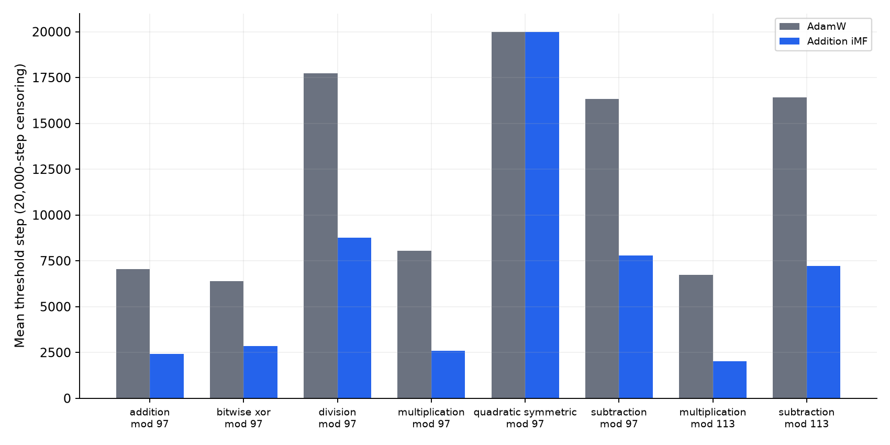
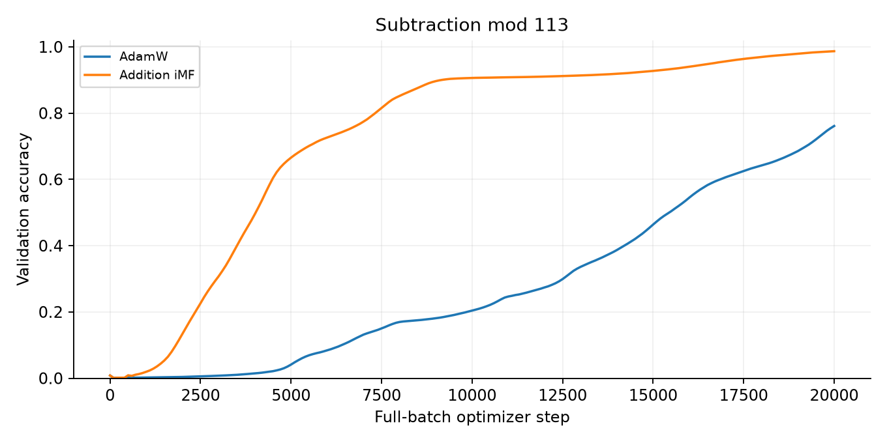
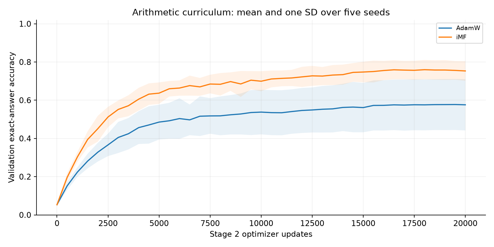

# Weight-MF
## Generative optimization through cross-task weight transfer

Weight-MF studies a generative optimizer that transfers learned weight updates across tasks. A one-shot generator trained with Improved MeanFlow on modular-addition checkpoint pairs proposes compatible transformer-block weights for new tasks. These proposals augment ordinary AdamW optimization through single or repeated block-level interventions. We evaluate cross-task transfer, compositional arithmetic, source-data budgets and causal controls.

## Method

The generative optimizer learns from source-task training trajectories and remains frozen during target-task training. Each generator call predicts an endpoint in one network evaluation. It can be used once or applied periodically during optimizer training. For a selected block W, the frozen generator predicts endpoint P from its weights, source-step prompts, training-subset loss and seeded noise. The intervention is W_new = W + alpha(P - W), followed by ordinary AdamW training. Embeddings learn through the target optimizer. Compatible matrix shapes permit transfer between blocks whose activation, normalization and residual computation differ.

## Cross-operation modular generalization
An addition-mod-113-trained generator replaces six target attention/MLP matrices once at step 500, prompting endpoint 9000, and resets their optimizer states. Embeddings continue to learn normally. Each task uses 20 paired seeds.

| Task | Modulus | Optimizer threshold steps | iMF threshold steps | Successes optimizer / iMF |
|---|---:|---:|---:|---:|
| Addition | 97 | 7,045 | 2,415 | 20 / 20 |
| Subtraction | 113 | 16,415 | 7,220 | 10 / 18 |
| Subtraction | 97 | 16,335 | 7,795 | 10 / 18 |
| Multiplication | 113 | 6,740 | 2,020 | 20 / 20 |
| Multiplication | 97 | 8,035 | 2,590 | 19 / 20 |
| Division | 97 | 17,720 | 8,770 | 10 / 18 |
| Bitwise XOR | 97 | 6,385 | 2,850 | 20 / 20 |
| Symmetric quadratic | 97 | Not reached | Not reached | 0 of 20 for each |

Neither the original optimizer-only models nor the generator-assisted models solve the symmetric-quadratic task to the generalization criterion within the 20,000-step budget. Their final accuracies can improve without reaching that criterion.

The generalization threshold requires at least 99% training accuracy and 95% validation accuracy for three consecutive evaluations, logged every 100 updates after the initial evaluation. Threshold means replace failures with the 20,000-step censoring limit; they combine learning speed and success probability. They are not means conditional on successful convergence.

### Individual operation learning curves

## Compositional arithmetic and attribution
The target is a five-block transformer learning elementary operations followed by bounded expressions with precedence. With 0.1-strength interventions every 500 steps in both stages, final mean holdout exact-answer accuracy improves from 57.18% to 75.17% over five paired seeds on one dataset. Four seeds improve and one declines.

| Treatment | Mean gain vs optimizer |
|---|---:|
| Reset only | +2.00 points |
| iMF with reset | +17.99 points |
| iMF preserving state | +18.59 points |
| Per-matrix update-norm-matched random directions | −7.21 points |

The norm-matched control is included even though it performs poorly: its mean holdout accuracy is **49.97%**, compared with **57.18%** for the optimizer and **75.17%** for the generator with reset. At every intervention, the control computes the generator proposal on its own current checkpoint, then replaces its direction with Gaussian noise scaled separately for each matrix to match the applied 0.1-strength displacement. It uses the same intervention schedule and optimizer-state reset. This matches the **update norm**, not the norm of the resulting weight matrix. The control therefore tests direction at matched displacement magnitude; it still incurs generator inference cost.

[Individual control results](results/controls/) include all five paired seeds, and the [implementation](experiments/curriculum/controls.py) specifies the matching and reset behavior.

## Source coverage, budget and inference horizon
A separate 602-run source recollection matched all 755 overlapping checkpoints exactly. The stratified-source generator reached 71.74% under the original prompt rule, versus 76.90% with a 100-step-ahead prompt. The transition-source reference reached 75.17%. This is an exploratory source/horizon interaction.

An earlier embedding-only source-count study compared 50/150/500 runs. The 500-source 10/90 treatment reached the recorded threshold in 3,690 mean steps versus 7,255 for optimizer. The baseline includes one run censored at 20,000 steps. This study uses a different representation and intervention protocol from the later block-generator experiments.

## Scope and next steps

The results support reusable block-weight interventions in controlled arithmetic. Fixed-data seed replication, causal controls and exact trajectory replay strengthen this finding. Source and target computations differ despite shared matrix dimensions; the compositional results measure fixed-budget accuracy, while the modular experiments measure time to a sustained generalization threshold. The generator augments AdamW; a standalone general-purpose optimizer has not been established. Some tasks, seeds and settings decline.

1. **Investigate norm-matched controls first.** Explain the deterioration under matched random directions and evaluate stable update-norm-matched, weight-norm-preserving and direct-donor controls. This is necessary to distinguish useful predicted directions from the effects of perturbation, shrinkage and reset.
2. **Develop and test a flow-map formulation.** Treat consistent mappings between checkpoints and compositions of shorter mappings as a future research direction. The current evidence concerns a one-shot endpoint generator; it does not establish a trajectory-consistent flow map.
3. **Confirm transfer on independent datasets.** Lock the treatment, tune ordinary optimizer baselines on development data, and evaluate paired seeds on untouched target draws.
4. **Measure total optimization cost.** Compare sustained validation-threshold crossing and wall time, including source collection, generator training and inference.

## Reproduction

Install with pip install -e . and run python scripts/run.py --help. Recorded metrics live under results/; new training writes under runs/. Source corpora and generator checkpoints are generated locally by the commands below.

Code layout, commands, protocols and reproducibility limits

#### Reproduction details

The README is the research narrative. This file specifies the executable experiments and distinguishes recorded measurements from newly generated outputs.

### Layout

- src/weightmf/: source transformer, checkpoint datasets, block/embedding generators and modular-task evaluation.
- experiments/: three command-line experiment implementations; curriculum/ contains the five-block architecture and the paired curriculum treatments.
- scripts/run.py: public entry point. New runs go to runs/, never to the recorded results.
- results/: tabular measurements, per-seed stage curves, and source/generator configurations.
- figures/: generated from results by scripts/plot_results.py.
- configs/: source splits and generator settings.

The code retains the historical numerical operations while removing unrelated task trainers and orchestration. The helper named experiments/curriculum/train.py contains only model construction, generator loading, and normalization.

### Environment

Use Python 3.11 or newer and a CUDA-compatible PyTorch 2.9 installation. Historical runs used Python 3.13 and CUDA PyTorch 2.9.1. Install with:

    python -m pip install -e .
    python scripts/run.py --help
    python -m unittest discover -s tests

Curriculum experiments require CUDA. Import/model tests and figure regeneration run on CPU.

### Figures and tables

    python scripts/run.py plots

This regenerates every README figure from the retained CSVs, including every individual modular operation. Bands denote one standard deviation over training seeds. They do not represent uncertainty over independent datasets. Source-scaling and modular threshold means both censor failures at 20,000 updates. Historical scaling_summary.csv also retains its original success-conditional means; censor_aware_summary.csv is the comparable statistic used by the README. Modular accuracy curves carry the last observation forward after a run stops; those plateaus are not further optimizer updates.

### Source corpus and generator

    python scripts/run.py collect-source
    python scripts/run.py train-generator --source transition

Collection replays source seeds 20000 through 20601 and keeps ten transition-focused pairs per successful trajectory. The generator uses the original 500/51/51 whole-run split and 10,000 training updates. If a specified source seed fails to reach the generalization threshold, collection stops instead of substituting a new seed. Outputs are data/source_transition and artifacts/transition.

    python scripts/run.py recollect-source
    python scripts/run.py train-generator --source stratified

Recollection requires the transition corpus first. It replays the same seeds and spans, matches each run's ten pair gaps, and draws starts from feasible-time deciles. The source split is in configs/transition/split_manifest.json. Outputs are data/source_stratified and artifacts/stratified.

Generator checkpoints and large corpora are generated locally and ignored by Git. There is no assumed private download location. Reproducing full training requires the collection/training commands above; these are computational experiments, not an instant evaluation script.

### Modular-operation transfer

    python scripts/run.py modular

Uses artifacts/transition/best_model.pt, the eight operation/modulus combinations, and paired seeds 31000-31019. The six matrices are replaced once at step 500 with endpoint prompt 9000 and corresponding AdamW state cleared. Division uses modular inverses over nonzero divisors; XOR labels are reduced modulo the output vocabulary. The input is three categorical tokens, not digit-level text.

Optional original CLI flags can follow the public arguments, for example:

    python scripts/run.py modular --output runs/modular_check --task multiplication:113 --trials 1

### Curriculum, attribution and horizons

    python scripts/run.py curriculum
    python scripts/run.py controls
    python scripts/run.py source-sampling
    python scripts/run.py horizons

The first command trains optimizer and 0.1 iMF treatments for seeds 101-105. The control command tests reset-only, iMF with reset, iMF preserving state, and Gaussian random directions matched per matrix to the contemporaneous applied 0.1 proposal. The last two commands require the stratified generator. Horizon comparisons use +100 and +200 against the original min(30000,max(9000,start+1000)) prompt rule.

Each stage runs 20,000 AdamW updates. Stage 1 learns elementary operations. Stage 2 starts from the minimum-validation-loss Stage 1 model with a fresh optimizer. Both stages supervise only the answer token. Stage 2 batches contain 115 composed and 13 elementary examples. Interventions occur before the next optimizer update at local steps 0,500,...,19500. Strength, intervention frequency and endpoint horizon are distinct parameters. See the source code and configs for the full protocol.

Generated datasets are disjoint by expression within train/validation/holdout. Dataset generation is deterministic with its fixed seed. Model/minibatch/noise pairing uses the same historical seed formulas. Five training seeds on one target dataset do not measure independent-dataset variability.

Choose a new --output directory for independent reruns; the historical runner resumes saved checkpoints and skips completed summaries within that output. It never treats the bundled results as a new execution. Interrupted source runs restart that trajectory; completed shards are reused.

### Embedding-only source-data experiment

    python scripts/run.py collect-embedding
    python scripts/run.py source-scaling

The historical split was drawn from 1,102 source trajectories (seeds 100-1201); preserving that candidate pool is necessary even when only 50,150,500 trajectories train each predictor. The scaling command trains predictors for 30,600 updates, uses fixed source validation/test memberships and twenty downstream seeds, and evaluates the 50/50 and 10/90 mixtures. This embedding-only velocity regression protocol differs from the later block iMF.

### Verification and limits

Reorganization checks exercise imports, model-copy equivalence, six-matrix round trips, dataset labels/splits, CLI dispatch, CSV-based summaries and figure regeneration. These checks do not rerun all historical GPU trials. Exact numerical reproduction across different devices or library versions is not guaranteed. The original same-host seed checks and source replay audit support the recorded execution, rather than a general cross-platform guarantee.

All selected results are experimental measurements. Endpoints at equal Stage 2 budget differ from validation-loss-selected checkpoints and from time-to-threshold metrics. Source collection and generator cost must be included before claiming end-to-end compute savings.

Public-release audit

The current files and published branch history passed Gitleaks and a separate metadata scan, including a fresh clone. Private author-email metadata, machine-local paths and operational notes were removed from the published history. No credential patterns were detected. Earlier unreferenced commits remain retrievable by identifier on GitHub; removing those retained objects requires a host-side purge. A history rewrite cannot erase previously downloaded copies.

## References

The generator builds on [Mean Flows](https://arxiv.org/abs/2505.13447) and [Improved Mean Flows](https://arxiv.org/abs/2512.02012). The deeper target architecture draws from [Self-Verifying Reflection](https://arxiv.org/abs/2510.12157), with a different answer-only protocol. This project studies transfer of learned weight interventions and its empirical behavior.
