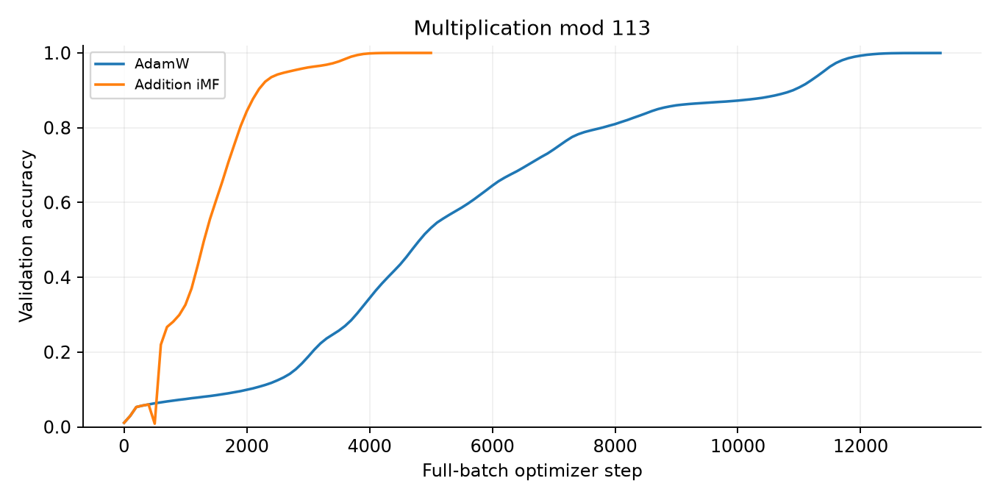
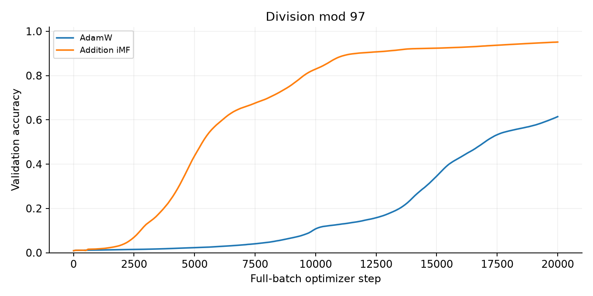
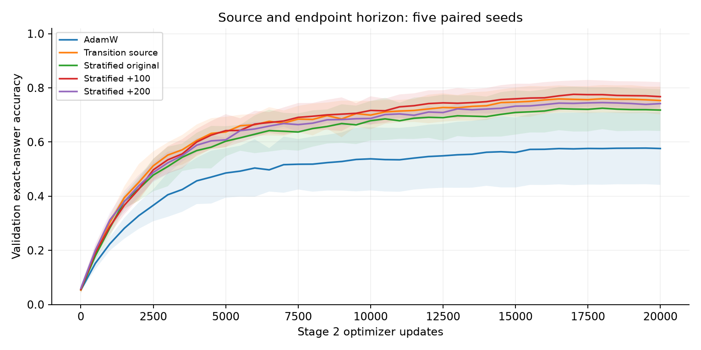
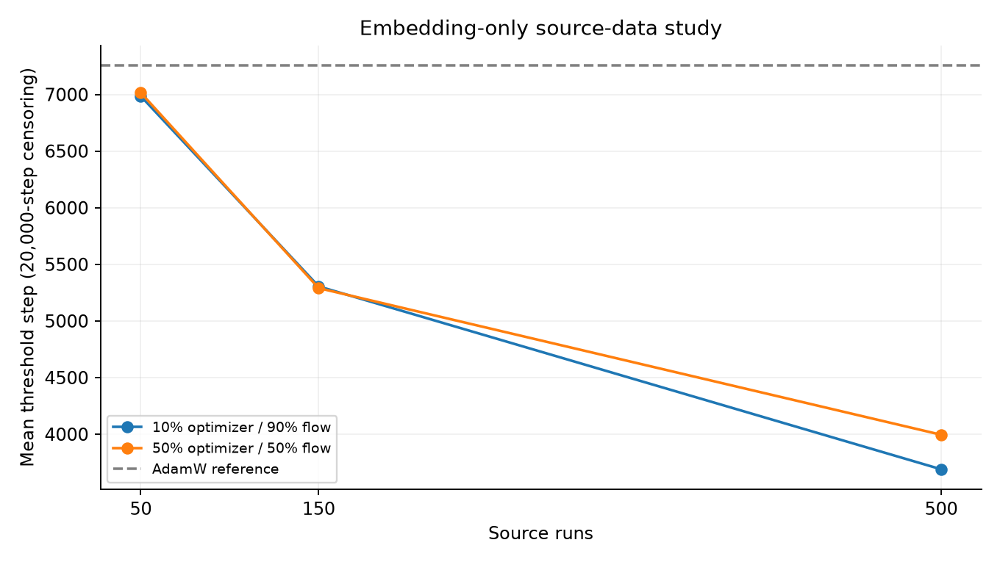

# Weight-MF
## Learning transferable weight dynamics from modular addition

A frozen improved MeanFlow generator learns from modular-addition checkpoint pairs and proposes compatible transformer-block weights for other tasks. This repository studies cross-operation transfer, compositional arithmetic, source-data budgets and causal controls.

## Method

For a selected block W, the frozen generator predicts endpoint P from its weights, source-step prompts, training-subset loss and seeded noise. The intervention is W_new = W + alpha(P - W), followed by ordinary AdamW training. Embeddings learn through the target optimizer. Compatible matrix shapes permit transfer between blocks whose activation, normalization and residual computation differ.

## Cross-operation modular generalization
An addition-mod-113-trained generator replaces six target attention/MLP matrices once at step 500, prompting endpoint 9000, and resets their optimizer states. Embeddings continue to learn normally. Each task uses 20 paired seeds.

| Task | Modulus | Optimizer threshold steps | iMF threshold steps | Successes optimizer / iMF |
|---|---:|---:|---:|---:|
| Addition | 97 | 7,045 | 2,415 | 20 / 20 |
| Subtraction | 113 | 16,415 | 7,220 | 10 / 18 |
| Subtraction | 97 | 16,335 | 7,795 | 10 / 18 |
| Multiplication | 113 | 6,740 | 2,020 | 20 / 20 |
| Multiplication | 97 | 8,035 | 2,590 | 19 / 20 |
| Division | 97 | 17,720 | 8,770 | 10 / 18 |
| Bitwise XOR | 97 | 6,385 | 2,850 | 20 / 20 |
| Symmetric quadratic | 97 | 20,000 | 20,000 | 0 / 0 |

Threshold means replace failures with the 20,000-step censoring limit; they combine learning speed and success probability. They are not means conditional on successful convergence.

### Individual operation learning curves

## Compositional arithmetic and attribution
The target is a five-block transformer learning elementary operations followed by bounded expressions with precedence. With 0.1-strength interventions every 500 steps in both stages, final mean holdout exact-answer accuracy improves from 57.18% to 75.17% over five paired seeds on one dataset. Four seeds improve and one declines.

| Treatment | Mean gain vs optimizer |
|---|---:|
| Reset only | +2.00 points |
| iMF with reset | +17.99 points |
| iMF preserving state | +18.59 points |
| Matched random directions | −7.21 points |

## Source coverage, budget and inference horizon
A separate 602-run source recollection matched all 755 overlapping checkpoints exactly. The stratified-source generator reached 71.74% under the original prompt rule, versus 76.90% with a 100-step-ahead prompt. The transition-source reference reached 75.17%. This is an exploratory source/horizon interaction.

An earlier embedding-only source-count study compared 50/150/500 runs. The 500-source 10/90 treatment reached the recorded threshold in 3,690 mean steps versus 7,255 for optimizer. The baseline includes one run censored at 20,000 steps. This study uses a different representation and intervention protocol from the later block-generator experiments.

## Scope and next steps
The results support reusable internal-weight interventions in controlled arithmetic. Fixed-data seed replication, causal controls and exact trajectory replay strengthen this finding. Independent datasets, tuned optimizer and direct-donor controls, and end-to-end compute accounting are next. Source/target computations differ despite shared matrix dimensions. Compositional accuracy gains alone do not demonstrate target grokking. Some tasks, seeds and settings decline.

## Reproduction

Install with pip install -e . and run python scripts/run.py --help. See [REPRODUCING.md](REPRODUCING.md) for collection, generator training, target experiments and plots. Recorded metrics live under results/; new training writes under runs/.

## References

The generator builds on [Mean Flows](https://arxiv.org/abs/2505.13447) and [Improved Mean Flows](https://arxiv.org/abs/2512.02012). The deeper target architecture draws from [Self-Verifying Reflection](https://arxiv.org/abs/2510.12157), with a different answer-only protocol. This project studies transfer of learned weight interventions and its empirical behavior.
