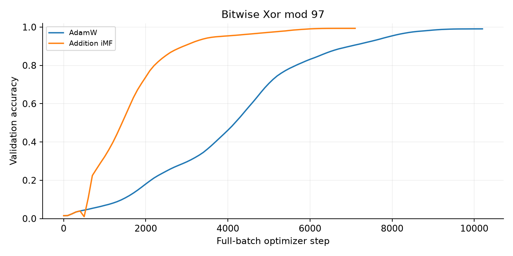
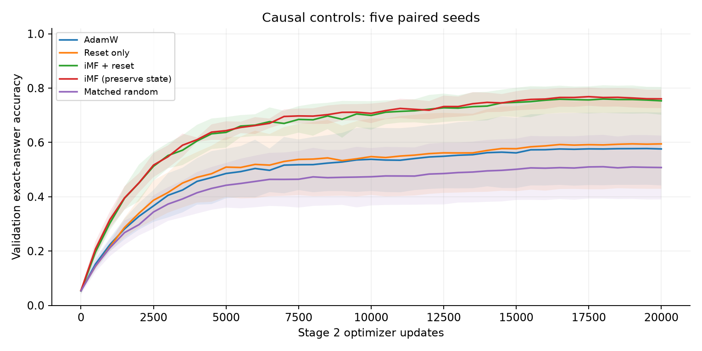

# Weight-MF

## Generative optimization through cross-task weight transfer

**Can a model trained on one task's optimization trajectories help another task learn faster?** Weight-MF studies this question with a frozen, one-shot generator of transformer-block weights. Trained with Improved MeanFlow (iMF) on modular-addition checkpoints, the generator proposes weights for new tasks and augments ordinary AdamW training through single or repeated interventions.

The strongest results show transfer across operations and into compositional arithmetic. On modular multiplication, a single addition-trained intervention reduces mean steps to the [generalization criterion](#cross-task-modular-transfer) from **6,740 to 2,020** across 20 paired seeds, approximately **70% fewer optimizer steps**. On a five-block arithmetic curriculum, repeated interventions improve mean final holdout accuracy from **57.18% to 75.17%** across five paired seeds. These measure target-training improvements; overall compute savings require accounting for source collection, generator training and inference.

[Method](#method) · [Cross-task results](#cross-task-modular-transfer) · [Compositional arithmetic](#compositional-arithmetic) · [Controls](#what-explains-the-improvement) · [Source data](#source-coverage-and-inference-horizon) · [Limitations](#limitations-and-next-steps) · [Reproduction](#reproduction)

## Research question and contribution

The research question is whether useful weight proposals transfer beyond the task that produced the training checkpoints. A generator can fit source trajectories without producing useful weights for a different objective. Weight-MF therefore evaluates proposals through downstream training behavior: time to a sustained validation threshold, success within a fixed budget, and held-out exact-answer accuracy.

The contribution is a structured checkpoint-learning and cross-task evaluation pipeline built on an existing iMF objective. It combines a transformer-block representation, a frozen conditional endpoint generator, and interventions whose strength, timing and optimizer-state handling can be controlled independently. Paired target seeds and matched perturbation controls test whether the learned proposals offer benefits beyond ordinary optimization, state resets and random displacements.

## Method

**Learn from within-run checkpoint pairs.** The main block generator uses 500 modular-addition training trajectories, retaining ten early–late pairs per trajectory. Another 51 trajectories are reserved for validation and 51 for testing. Splits are made by complete source run, and normalization statistics use only the training runs. The initial source corpus favors checkpoints near the sustained generalization threshold; a later experiment varies this sampling strategy.

**Represent the block's attention and MLP structure.** The source transformer has one block, hidden width 128, four attention heads and MLP width 512. The generator models six matrices: query, key, value, attention output, and the two MLP projections. Its tokens couple the corresponding components of each attention head and the input/output components of each MLP neuron. A latent-attention network processes these tokens without learned head or neuron positions. This representation retains structural relationships while allowing compatible blocks to share the generator.

**Generate a proposed endpoint in one evaluation.** The approximately 15.34-million-parameter iMF model conditions on the current block, start/end step prompts and loss prompts. Training learns to generate later checkpoints from noise using the iMF average-velocity and instantaneous-velocity objective. At inference, seeded Gaussian noise and the checkpoint conditions produce a proposed block in a single network evaluation. The generator remains frozen during target training; no target-task checkpoint trajectories are used to retrain it.

**Use the proposal as a block-level optimization intervention.** For current block weights `W`, generated weights `P`, and strength `alpha`, apply:

```text
W_new = W + alpha * (P - W)
```

AdamW then continues training. Full replacement uses `alpha = 1`; smaller strengths move partway toward the generated endpoint. Embeddings, output weights and all untargeted parameters continue through ordinary optimization. The modular-transfer experiment replaces the single block once, while the compositional experiment repeatedly updates the first block of a five-block target.

The generator predicts an endpoint conditioned on nominal training progress. Its step prompt is not a guarantee that the proposal equals a target-task checkpoint at that step. The current method is a one-shot weight generator used for generative optimization; consistency as a flow map remains a future research question.

[Generator implementation](src/weightmf/transformer_weight_meanflow.py) · [iMF objective and sampler](src/weightmf/meanflow_objective.py) · [Training and source split](src/weightmf/transformer_weight_meanflow_training.py)

## Cross-task modular transfer

**An addition-trained generator accelerates several new operations without further source pretraining.** The source task is addition modulo 113. Each target uses 20 paired seeds; the treatment replaces the six attention/MLP matrices after optimizer step 500 with a generated endpoint prompted at step 9,000, clears their AdamW states, and resumes training. Target inputs are three categorical tokens representing whole integers and the answer position.

**How to read the plot:** a run reaches the generalization criterion when training accuracy is at least 99% and validation accuracy is at least 95% for three consecutive evaluations, spaced 100 updates apart after the initial evaluation. The plotted value is the mean number of optimizer updates needed to reach that criterion; lower is better. Runs that do not reach it are counted at the 20,000-update limit, so the means reflect both learning speed and failure to converge.

Neither the original optimizer-only models nor the generator-assisted models learn the symmetric-quadratic task to this criterion: both have zero successful runs out of 20. Higher final accuracy in that treatment does not establish a solved task.


*Figure 1. Addition-trained block generation reduces threshold steps across several operations. The symmetric-quadratic bars indicate the censoring limit for unsuccessful runs.*

[Aggregate measurements](results/modular_transfer/aggregate_summary.csv) · [Individual trials](results/modular_transfer/trial_summary.csv) · [Transfer implementation](src/weightmf/transformer_weight_downstream.py)

<details>
<summary>Individual operation learning curves</summary>




*Each curve averages validation accuracy over 20 target seeds. The last observation is carried forward after a run stops; those plateaus do not represent additional optimizer updates.*

</details>

## Compositional arithmetic

**Repeated addition-trained proposals also improve fixed-budget learning on a different arithmetic representation.** The target is a five-block transformer that first learns elementary operations, then learns bounded expressions with three to six operands and operator precedence. Inputs use whole-number and operation tokens; divisions are exact and exclude zero divisors. Both curriculum stages run for 20,000 AdamW updates and supervise the answer token.

The treatment applies a 0.1-strength proposal to the first block at local steps 0, 500, 1,000, and so on in both stages. Stage 2 starts from the minimum-validation-loss Stage 1 checkpoint with a fresh optimizer. At the final Stage 2 endpoint, mean holdout exact-answer accuracy rises from **57.18% to 75.17%**, a **17.99-percentage-point** paired improvement. Four of five seeds improve; one declines. The sample standard deviation of the paired improvement is 15.14 points. These are five training seeds on one fixed dataset, with schedules selected through exploratory experiments.


*Figure 2. Validation accuracy during Stage 2, with mean and one sample standard deviation across five paired seeds. The headline numbers are final holdout accuracies, a separate measurement from the validation curves.*

The transfer crosses a computational difference despite compatible matrix shapes. The source uses a single block with ReLU, sequential residual updates and no LayerNorm; the target uses five blocks with GELU, pre-LayerNorm, parallel residual updates and partial rotary positions. The experiment demonstrates transfer between these compatible weight layouts, without establishing arbitrary-architecture transfer.

[Per-seed curriculum results](results/curriculum/) · [Target architecture](experiments/curriculum/modeling.py) · [Paired training protocol](experiments/curriculum/paired.py)

## What explains the improvement?

**The available controls support a role for the learned weight direction beyond optimizer-state resets.** All treatments below use the same five paired target seeds and final holdout metric. Proposal interventions use strength 0.1 every 500 updates in both stages.

**Table 1. Optimizer-state and displacement controls.** Higher final holdout accuracy is better; gains are percentage points relative to AdamW.

| Treatment | Mean holdout accuracy | Gain vs AdamW |
|---|---:|---:|
| AdamW | 57.18% | — |
| Reset targeted optimizer state only | 59.18% | +2.00 |
| Weight-MF with state reset | **75.17%** | **+17.99** |
| Weight-MF preserving state | 75.77% | +18.59 |
| Per-matrix displacement-norm-matched random directions | 49.97% | -7.21 |

The random control matches the magnitude of the proposed update separately for each matrix. At each intervention it computes the generator proposal on its own current checkpoint, replaces its direction with Gaussian noise scaled to the same applied displacement norm, and clears the same optimizer states. It matches update norms rather than resulting weight norms and retains the cost of generator inference.

The random control performs worse than AdamW, while preserving optimizer state retains the learned-proposal gain. These observations distinguish the learned proposals from the tested resets and random perturbations. They do not establish superiority to every perturbation control, direct donor checkpoint or tuned optimizer baseline.



*Figure 3. Stage 2 validation curves for the control treatments; bands show one sample standard deviation across five paired seeds.*

[Individual control results](results/controls/) · [Control implementation](experiments/curriculum/controls.py)

## Source coverage and inference horizon

**Checkpoint sampling and endpoint prompting interact.** A separate 602-run recollection uses the same 500/51/51 source-run split and matches all 755 overlapping checkpoints exactly. With stratified checkpoint sampling, mean final holdout accuracy is 71.74% under the original endpoint-prompt rule and 76.90% under a 100-step-ahead prompt; the transition-focused reference reaches 75.17%. These exploratory comparisons use the same target dataset and do not establish a reliable advantage for one sampling strategy.


*Figure 4. Stage 2 validation curves for source-sampling and endpoint-horizon choices, averaged over five paired seeds. Final holdout measurements are reported in the text.*

[Source replay audit](results/source_sampling/trajectory_audit.json) · [Transition generator configuration](configs/transition/summary.json) · [Stratified generator configuration](configs/stratified/summary.json) · [Horizon results](results/horizons/)

### Earlier embedding-only source-budget study

A separate experiment compares predictors trained on 50, 150 and 500 source runs. The 500-source treatment, mixing 10% optimizer update and 90% predicted update, reaches the recorded threshold in 3,690 mean steps versus 7,255 for AdamW. The baseline includes one run censored at 20,000 steps. This study uses direct embedding-velocity regression, a different representation and intervention protocol from the later transformer-block iMF generator; it should not be read as a block-generator scaling law.


*Figure 5. Censor-aware threshold means for the earlier embedding-only study. The retained source budgets are evaluated with fixed source validation/test membership and paired downstream seeds.*

[Censor-aware source-budget results](results/source_scaling/censor_aware_summary.csv)

## Limitations and next steps

The evidence supports reusable block-weight interventions in controlled arithmetic. Performance varies by task, seed and intervention setting. The modular experiments measure time to a sustained generalization threshold; the compositional experiments measure fixed-budget accuracy. Neither establishes a standalone general-purpose optimizer, large-language-model acceleration or net compute savings.

1. **Investigate norm-matched controls first.** Explain the deterioration under the matched random control and test stable update-norm-matched, weight-norm-preserving and direct-donor alternatives. Separate learned direction from shrinkage, perturbation and reset effects.
2. **Test locked protocols on independent datasets.** Fix schedules and strengths before evaluation, tune ordinary optimizer baselines on development data, and compare paired target seeds on untouched dataset draws. Five seeds on one compositional dataset leave substantial uncertainty.
3. **Develop and evaluate a flow-map formulation.** Test whether mappings between checkpoints compose consistently across shorter horizons. The present one-shot generator does not establish this property.
4. **Measure complete optimization cost and broader transfer.** Include source collection, generator training and inference in wall-time and compute comparisons, and evaluate additional model widths and target representations.

## Reproduction

Install with pip install -e . and run python scripts/run.py --help. Recorded metrics live under results/; new training writes under runs/. Source corpora and generator checkpoints are generated locally by the commands below.

<details>
<summary>Code layout, commands, protocols and reproducibility limits</summary>

#### Reproduction details

The README is the research narrative. This file specifies the executable experiments and distinguishes recorded measurements from newly generated outputs.

### Layout

- src/weightmf/: source transformer, checkpoint datasets, block/embedding generators and modular-task evaluation.
- experiments/: three command-line experiment implementations; curriculum/ contains the five-block architecture and the paired curriculum treatments.
- scripts/run.py: public entry point. New runs go to runs/, never to the recorded results.
- results/: tabular measurements, per-seed stage curves, and source/generator configurations.
- figures/: generated from results by scripts/plot_results.py.
- configs/: source splits and generator settings.

The code retains the historical numerical operations while removing unrelated task trainers and orchestration. The helper named experiments/curriculum/train.py contains only model construction, generator loading, and normalization.

### Environment

Use Python 3.11 or newer and a CUDA-compatible PyTorch 2.9 installation. Historical runs used Python 3.13 and CUDA PyTorch 2.9.1. Install with:

    python -m pip install -e .
    python scripts/run.py --help
    python -m unittest discover -s tests

Curriculum experiments require CUDA. Import/model tests and figure regeneration run on CPU.

### Figures and tables

    python scripts/run.py plots

This regenerates every README figure from the retained CSVs, including every individual modular operation. Bands denote one standard deviation over training seeds. They do not represent uncertainty over independent datasets. Source-scaling and modular threshold means both censor failures at 20,000 updates. Historical scaling_summary.csv also retains its original success-conditional means; censor_aware_summary.csv is the comparable statistic used by the README. Modular accuracy curves carry the last observation forward after a run stops; those plateaus are not further optimizer updates.

### Source corpus and generator

    python scripts/run.py collect-source
    python scripts/run.py train-generator --source transition

Collection replays source seeds 20000 through 20601 and keeps ten transition-focused pairs per successful trajectory. The generator uses the original 500/51/51 whole-run split and 10,000 training updates. If a specified source seed fails to reach the generalization threshold, collection stops instead of substituting a new seed. Outputs are data/source_transition and artifacts/transition.

    python scripts/run.py recollect-source
    python scripts/run.py train-generator --source stratified

Recollection requires the transition corpus first. It replays the same seeds and spans, matches each run's ten pair gaps, and draws starts from feasible-time deciles. The source split is in configs/transition/split_manifest.json. Outputs are data/source_stratified and artifacts/stratified.

Generator checkpoints and large corpora are generated locally and ignored by Git. There is no assumed private download location. Reproducing full training requires the collection/training commands above; these are computational experiments, not an instant evaluation script.

### Modular-operation transfer

    python scripts/run.py modular

Uses artifacts/transition/best_model.pt, the eight operation/modulus combinations, and paired seeds 31000-31019. The six matrices are replaced once at step 500 with endpoint prompt 9000 and corresponding AdamW state cleared. Division uses modular inverses over nonzero divisors; XOR labels are reduced modulo the output vocabulary. The input is three categorical tokens, not digit-level text.

Optional original CLI flags can follow the public arguments, for example:

    python scripts/run.py modular --output runs/modular_check --task multiplication:113 --trials 1

### Curriculum, attribution and horizons

    python scripts/run.py curriculum
    python scripts/run.py controls
    python scripts/run.py source-sampling
    python scripts/run.py horizons

The first command trains optimizer and 0.1 iMF treatments for seeds 101-105. The control command tests reset-only, iMF with reset, iMF preserving state, and Gaussian random directions matched per matrix to the contemporaneous applied 0.1 proposal. The last two commands require the stratified generator. Horizon comparisons use +100 and +200 against the original min(30000,max(9000,start+1000)) prompt rule.

Each stage runs 20,000 AdamW updates. Stage 1 learns elementary operations. Stage 2 starts from the minimum-validation-loss Stage 1 model with a fresh optimizer. Both stages supervise only the answer token. Stage 2 batches contain 115 composed and 13 elementary examples. Interventions occur before the next optimizer update at local steps 0,500,...,19500. Strength, intervention frequency and endpoint horizon are distinct parameters. See the source code and configs for the full protocol.

Generated datasets are disjoint by expression within train/validation/holdout. Dataset generation is deterministic with its fixed seed. Model/minibatch/noise pairing uses the same historical seed formulas. Five training seeds on one target dataset do not measure independent-dataset variability.

Choose a new --output directory for independent reruns; the historical runner resumes saved checkpoints and skips completed summaries within that output. It never treats the bundled results as a new execution. Interrupted source runs restart that trajectory; completed shards are reused.

### Embedding-only source-data experiment

    python scripts/run.py collect-embedding
    python scripts/run.py source-scaling

The historical split was drawn from 1,102 source trajectories (seeds 100-1201); preserving that candidate pool is necessary even when only 50,150,500 trajectories train each predictor. The scaling command trains predictors for 30,600 updates, uses fixed source validation/test memberships and twenty downstream seeds, and evaluates the 50/50 and 10/90 mixtures. This embedding-only velocity regression protocol differs from the later block iMF.

### Verification and limits

Reorganization checks exercise imports, model-copy equivalence, six-matrix round trips, dataset labels/splits, CLI dispatch, CSV-based summaries and figure regeneration. These checks do not rerun all historical GPU trials. Exact numerical reproduction across different devices or library versions is not guaranteed. The original same-host seed checks and source replay audit support the recorded execution, rather than a general cross-platform guarantee.

All selected results are experimental measurements. Endpoints at equal Stage 2 budget differ from validation-loss-selected checkpoints and from time-to-threshold metrics. Source collection and generator cost must be included before claiming end-to-end compute savings.

</details>

<details>
<summary>Public-release audit</summary>

The current files and published branch history passed Gitleaks and a separate metadata scan, including a fresh clone. Private author-email metadata, machine-local paths and operational notes were removed from the published history. No credential patterns were detected. Earlier unreferenced commits remain retrievable by identifier on GitHub; removing those retained objects requires a host-side purge. A history rewrite cannot erase previously downloaded copies.

</details>

## References

The generator uses [Mean Flows](https://arxiv.org/abs/2505.13447) and [Improved Mean Flows](https://arxiv.org/abs/2512.02012). The deeper target architecture draws from [Self-Verifying Reflection](https://arxiv.org/abs/2510.12157), with a different answer-only training protocol. Weight-MF's contribution is the structured checkpoint-learning, block intervention and cross-task evaluation pipeline; it does not introduce the underlying MeanFlow objective.
